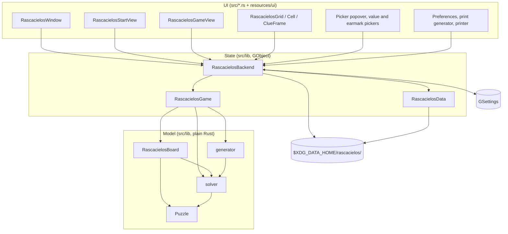
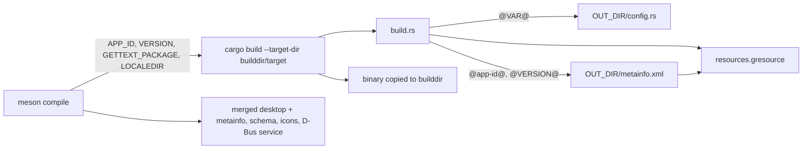

# Architecture

## Layers

- **Model.** `puzzle.rs`, `solver.rs` and `generator.rs` have no GTK or GLib
  dependency and use heights 1..N. `board.rs` adds the play state (values,
  earmarks, duplicate counts, candidates) with **0-based** values: index `h`
  is height `h + 1`. The JSON save converts back to 1..N.
- **State.** `RascacielosGame` is a GObject around one `RascacielosBoard`. It
  holds the undo/redo stack and the clock, and emits signals for every change.
  `RascacielosBackend` is the single object every widget receives in `init()`.
  It owns the current game, the GSettings bindings, autosave, the save files
  and `RascacielosData`.
- **UI.** Widgets never touch a `RascacielosGame` directly to change it. They
  call `backend.game_*()` methods, which honour the preferences (for example
  autoclean earmarks), and they listen to game signals to update.

## Design patterns

- **GObject subclassing.** Every widget and state object has a private `imp`
  module, a `glib::wrapper!` and, where it has a template,
  `#[derive(CompositeTemplate)]` with
  `#[template(resource = "/io/github/nacho/rascacielos/ui/<name>.ui")]`.
- **Late initialisation.** Widgets are built from templates or with
  `new_uninitialized()`, then `init(&backend)` stores the backend in a
  `OnceCell` and connects the signals.
- **Reconnect on game change.** The backend emits `game-changed` whenever a
  game is generated, loaded or started from a share code. Each widget's
  `add_game_hooks()` connects to the new `RascacielosGame`'s signals.
- **Fixed widget pool.** The grid, the clue frame and the pickers create the
  widgets for `MAX_SIZE` (7) once and hide the ones beyond the current size.
- **Actions.** App actions live in a `SimpleActionGroup` inserted as `app` on
  the window, not on the `GApplication`. Widgets install their own groups:
  `game-view.*`, `grid.*` and `cell.*` (see `interfaces.md`).
- **Settings as properties.** Each GSettings key is bound to a `pref_*`
  property of the backend. Widgets connect to `notify::pref-*`.
- **Blocking generation off the main thread.** `RascacielosGame::generate`
  runs on every processor with `std::thread::scope` and blocks until it has
  enough puzzles. UI callers wrap it in `gio::spawn_blocking` inside
  `glib::spawn_future_local`.
- **GTK drawing.** Clues and printed pages are drawn with `gtk::Snapshot` and
  `gsk::Path`. The printer only uses cairo to hand the render node to the
  print context.

## Build architecture

Plain `cargo build` uses the defaults in `build.rs` (Devel app ID, locale dir
`/usr/share/locale`). The about dialog reads the metainfo compiled into the
GResource, so it works without Meson.
