# Codebase information

## Identity

| | |
|---|---|
| Name | Rascacielos, a skyscrapers ("Towers") puzzle for GNOME |
| Origin | Fork of GNOME Sudoku at `b40cbd00017c19fb0d2b2286254082744f434510` |
| App ID | `io.github.nacho.rascacielos` (`.Devel` for the Devel profile and plain Cargo builds) |
| Resource path | `/io/github/nacho/rascacielos/` |
| Log domain | `rascacielos` (`crate::G_LOG_DOMAIN`) |
| Gettext package | `rascacielos` |
| License | GPL-3.0-or-later |
| Type prefix | `Rascacielos` (GObject types), `rascacielos-` (CSS nodes, custom properties) |

## Languages

| Language | Where | Analysed |
|---|---|---|
| Rust (edition 2024) | `src/`, `build.rs` | Yes |
| GTK Builder XML | `resources/ui/*.ui` | Yes, for template children and actions |
| CSS | `resources/style.css` | Only for the class names the code sets |
| Meson | `meson.build`, `data/`, `po/` | Yes |
| GSettings schema, desktop, metainfo, D-Bus service | `data/` | Yes |
| Gettext PO | `po/` (Spanish only) | Not reviewed for content |
| SVG | `data/application-icons/`, `resources/icons/` | No |

There are no languages the analysis could not read.

## Structure

```mermaid
graph TD
    root[rascacielos/]
    root --> src[src/ application]
    root --> lib[src/lib/ model and logic]
    root --> res[resources/ GResource: ui, css, icons]
    root --> data[data/ desktop, metainfo, schema, icons, screenshots]
    root --> po[po/ translations]
    root --> aux[build-aux/ Flatpak manifest, pre-commit]
    root --> ci[.github/workflows/ci.yml]
    root --> build[build.rs, Cargo.toml, meson.build]

    src --> app[main.rs, window.rs]
    src --> views[start_view.rs, game_view.rs]
    src --> board[grid.rs, cell.rs, grid_layout.rs, clue.rs, clue_frame.rs]
    src --> pick[picker_popover.rs, value_picker.rs, earmark_picker.rs]
    src --> dlg[preferences_dialog.rs, print_generator_dialog.rs, printer.rs, menu_button.rs]
    src --> uit[ui_tests.rs]

    lib --> pure[puzzle.rs, solver.rs, generator.rs: no GTK]
    lib --> state[board.rs, game.rs, backend.rs, data.rs]
    lib --> misc[enums.rs, utils.rs]
```

## Technology stack

- GTK 4 (crate `gtk4` with feature `v4_22`) and libadwaita (crate `libadwaita`
  with feature `v1_9`).
- GLib and GIO through the gtk-rs bindings, with GSettings, GResource,
  GApplication D-Bus activation and the GLib log macros.
- Cargo for development. Meson wraps Cargo for installation, translations and
  the data files.
- Flatpak: the Devel manifest uses the GNOME 51 runtime with the
  `rust-stable` SDK extension.
- GitHub Actions on `ubuntu-26.04`.

See `dependencies.md` for the crates.
