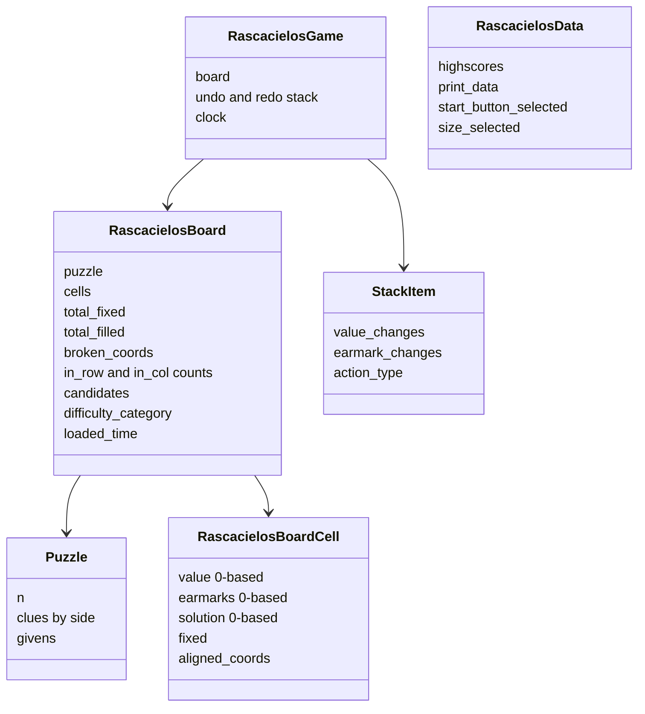

# Data models

The file formats on disk (share code, text format, JSON save) are in
`formats.md`. The solver's candidate masks are in `puzzles.md`.

## Height indexing

| Where | Heights |
|---|---|
| `Puzzle`, solver, generator, share code, text format, JSON save | 1..N, with 0 or `None` for empty |
| `RascacielosBoard`, `RascacielosGame`, backend `game_*`, widgets | 0..N−1: index `h` is height `h + 1` |
| Solver candidates (`u16`) | Bit `h` for height `h` (1-based bits) |

Getting this wrong is the most common off-by-one in this codebase.

## Enums (`lib/enums.rs`, `lib/puzzle.rs`)

- `DifficultyCategory`: `Unknown`, `Easy` (default), `Medium`, `Hard`,
  `VeryHard`, `Custom`. It is a `glib::Enum` and is serialised by name in
  saves and the data file. `to_tier()` and `from_tier()` map the four real
  difficulties to `puzzle::Tier`. `Custom` is a valid puzzle that only the
  backtracking search solves.
- `Tier`: `Easy`, `Medium`, `Hard`, `VeryHard`. Has `easier()`.
- `Side`: `Top`, `Bottom`, `Left`, `Right`. `index()` gives the order of the
  clue arrays.
- `ClueConflict`: `Full` (a full line shows a different count) or `Early`
  (the cells already filled next to the clue contradict it).
- `ZoomLevel`: `None`, `Small`, `Medium`, `Large`, with value and earmark
  font multipliers. Stored in GSettings as `small`, `medium` or `large`.
- `StackAction`: `None`, `Insert`, `Remove`, `EnableEarmark`,
  `DisableEarmark`, `DisableAllEarmarks`, `InsertAndDisableAlignedEarmarks`,
  `EnableAllEarmarkPossibilities`, `Reset`.
- `CompatValue(i32)`: an `Option<usize>` passed through signals as an
  `i32`, with `i32::MAX` for `None`.
- `RascacielosError`: `FileNotFound`, `InvalidPuzzle`, `MultipleSolutions`,
  `InvalidSaveData`, `InvalidSharedPuzzle`.

## Persistent data

### GSettings (`data/io.github.nacho.rascacielos.gschema.xml`)

Gameplay keys, each bound to a backend property:

| Key | Backend property |
|---|---|
| `show-possibilities` | `pref_show_all_possibilities` |
| `duplicate-warnings` | `pref_duplicate_warnings` |
| `earmark-warnings` | `pref_earmark_warnings` |
| `clue-warnings` | `pref_clue_warnings` |
| `solution-warnings` | `pref_solution_warnings` |
| `show-timer` | `pref_timer` |
| `autoclean-earmarks` | `pref_autoclean_earmarks` |
| `number-picker-second-click` | `pref_picker_second_click` |
| `highlight-row-column` | `pref_highlight_row_column` |
| `highlight-numbers` | `pref_highlight_numbers` |
| `zoom-level` | `pref_zoom` |

Window state keys, bound in `window.rs`: `default-width`, `default-height`,
`window-is-maximized`, `window-is-fullscreen`.

### Data file (`$XDG_DATA_HOME/rascacielos/data`, JSON)

`RascacielosData`. Each field has a serde default, so older files still load.

- `highscores`: a list of `{size, difficulty, time}` entries, one per size and
  difficulty pair.
- `print_data`: `{number_of_puzzles, number_of_puzzles_per_page,
  difficulty, size}`.
- `start_button_selected`: the last difficulty.
- `size_selected`: the last size, `DEFAULT_SIZE` (5) by default.

### Save directories

| Path | Content |
|---|---|
| `savefile` | The active game. It is saved every 5 minutes and when the backend is disposed, and the data file is saved at the same time. |
| `finished/` | Archived finished games |
| `printed/` | Every printed puzzle |
| `saved/` | Default folder for "Save as", with `<N>x<N>.save` as the file name |
