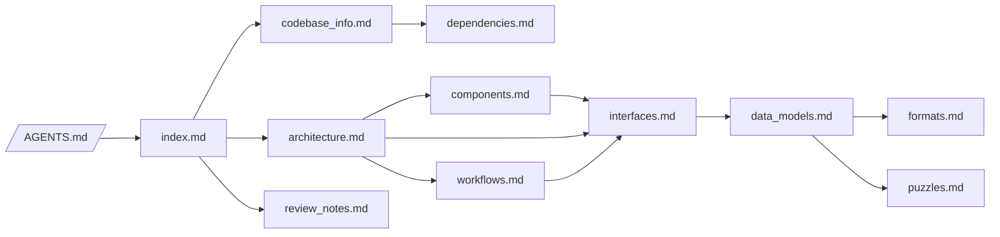

# Rascacielos knowledge base

## How to use this knowledge base

You are working on Rascacielos, a GTK 4 / libadwaita skyscrapers puzzle in
Rust, forked from GNOME Sudoku. Start with `/AGENTS.md`, which covers the
layout, the patterns that are easy to get wrong and the project conventions.
Use this index to pick the one or two files below that answer your question,
and read only those. Each file is self-contained and links to the others where
they overlap.

If the code and these files disagree, the code is right. Update the file.

## Files

| File | Read it when | Contents |
|---|---|---|
| `codebase_info.md` | You need the identity, the languages or a map of the tree | App ID, resource path, log domain, structure diagram, stack |
| `architecture.md` | You need to understand how the layers talk, or how the Cargo and Meson builds fit together | Layer diagram, design patterns (backend facade, `game-changed` hooks, widget pool, threads), build pipeline |
| `components.md` | You need to find the file or the type for a feature | One table per area: window, views, board widgets, pickers, dialogs, state, model, tests |
| `interfaces.md` | You connect a signal, add or call an action, use the backend, or call the model API | Signals, action groups, the `game_*` facade, the puzzle, solver and generator APIs, external integration points |
| `data_models.md` | You touch board state, enums, settings or persistence | Class diagram, **0-based versus 1-based heights**, enums, GSettings keys and their properties, data file, save directories |
| `puzzles.md` | You change the solver, the generator or difficulty grading | Puzzle model, solver tiers and techniques, generator algorithm, measured availability table |
| `formats.md` | You change import, export, share or save | Share code, text format, JSON save with examples |
| `workflows.md` | You follow a flow end to end | Sequence diagrams for generating a game and playing a move, opening files and share codes, finishing, printing, release pointer |
| `dependencies.md` | You add a crate or change toolkit versions | Crates and why each one is there, system requirements, tooling |
| `review_notes.md` | Before you trust a detail, or when you look for cleanup work | Known inconsistencies in the code (a dead shortcut, a dead action, stale comments, version checks), documentation gaps |

## Which file for which question

- "Where is X drawn or handled?" → `components.md`, then `architecture.md`.
- "Why is my value off by one?" → `data_models.md` (height indexing).
- "Which signal or action do I use?" → `interfaces.md`.
- "Why is this difficulty unavailable or slow?" → `puzzles.md`.
- "What does a save or share code look like?" → `formats.md`.
- "What happens when the user clicks New game?" → `workflows.md`.
- "Can I add this dependency?" → `dependencies.md` and the conventions in
  `/AGENTS.md`.

## Relationships

## Maintenance

- After you change the solver, re-run
  `cargo test --release -- --ignored --nocapture measure_availability` and
  update `puzzles.md`.
- After you add a widget, action, signal or setting, update
  `components.md`, `interfaces.md` or `data_models.md`.
- The "Custom Instructions" section of `/AGENTS.md` is maintained by hand.
  Don't regenerate it.
