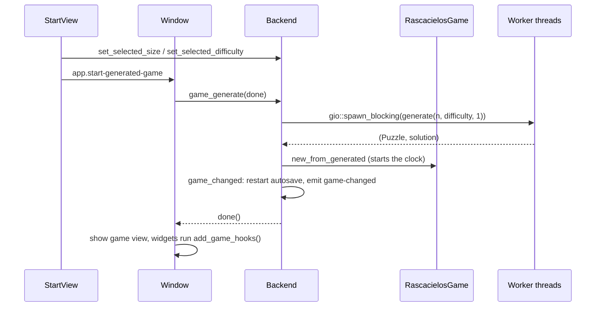
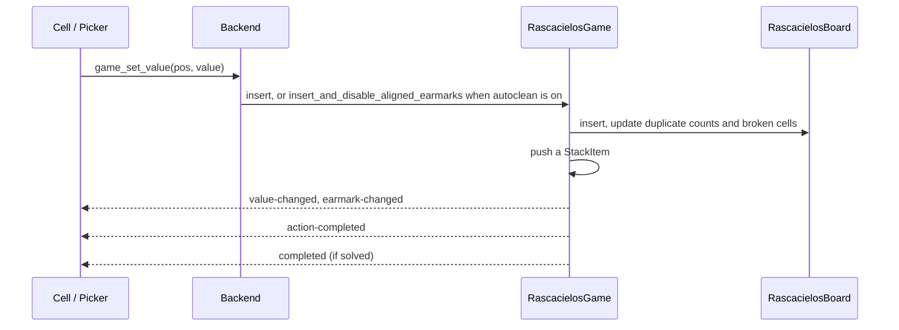

# Workflows

## Starting a generated game

1. The start view stores the size (`AdwToggleGroup`) and difficulty in
   `RascacielosData`.
2. `app.start-generated-game` → `RascacielosBackend::game_generate`, which runs
   `RascacielosGame::generate` in `gio::spawn_blocking` and then emits
   `game-changed`.
3. On `game-changed` the window shows the game view, and the grid, clue
   frame and pickers reload from the new game and reconnect their hooks.

## Opening a file or a share code

- **Open file** (start view): `game_load(path)` tries the JSON save format,
  then the text format. A text puzzle goes through `RascacielosGame::solve`,
  which grades it, or marks it `Custom` when only the search solves it. It
  fails on no solution or several.
- **Share code**: while the "Custom" row is selected, the start view watches
  the clipboard. `check_clipboard` parses it into `tgame`. The start button
  calls `tgame_start()`, which moves it to the current game and emits
  `game-changed`.

## Playing a move

Undo and redo replay a `StackItem` and emit the same signals.

## Finishing a game

`RascacielosGame` emits `completed` when every cell is filled, no height repeats
and every clue holds. The game view plays the completion animation, saves
the highscore for the size and difficulty and shows the completed dialog. The
backend deletes `savefile`, archives the game in `finished/` and stops
autosave.

## Printing

The print generator dialog generates the puzzles with
`RascacielosGame::generate` in `gio::spawn_blocking`, optionally adds the
current puzzle first, saves each board in `printed/` and hands them to
`RascacielosPrinter`. The printer draws each page with `gtk::Snapshot`.

## Release

See "Release Process" in `/AGENTS.md`.
